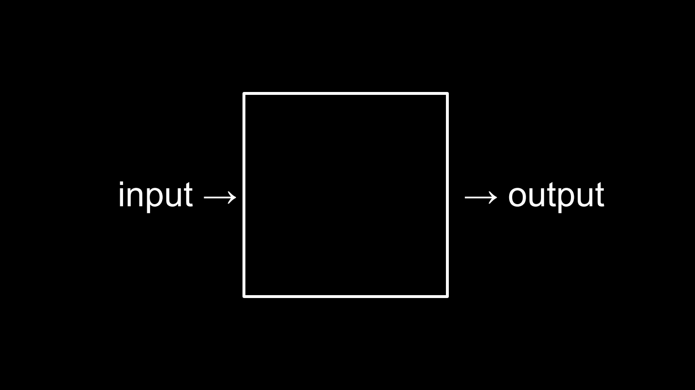
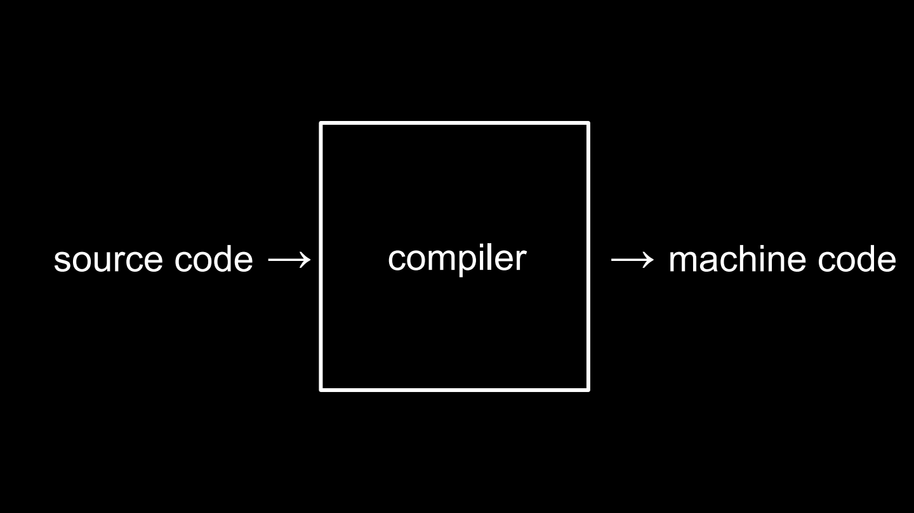
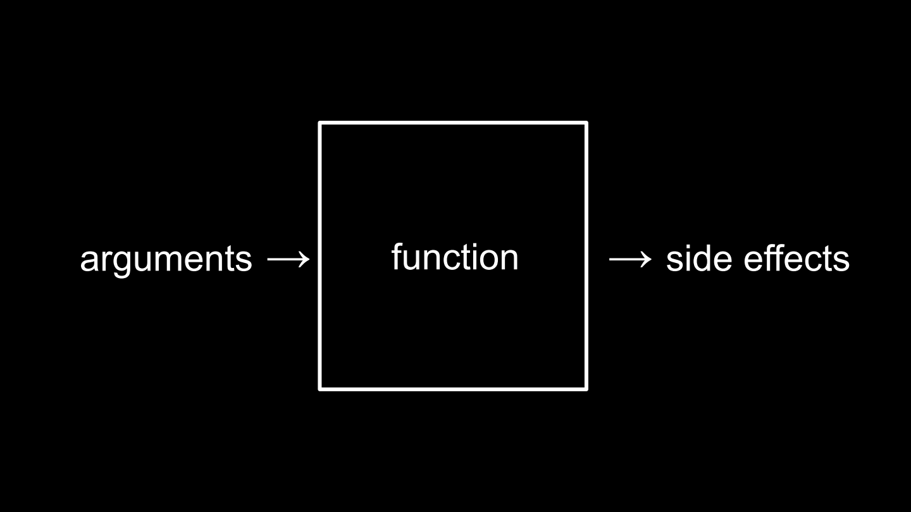
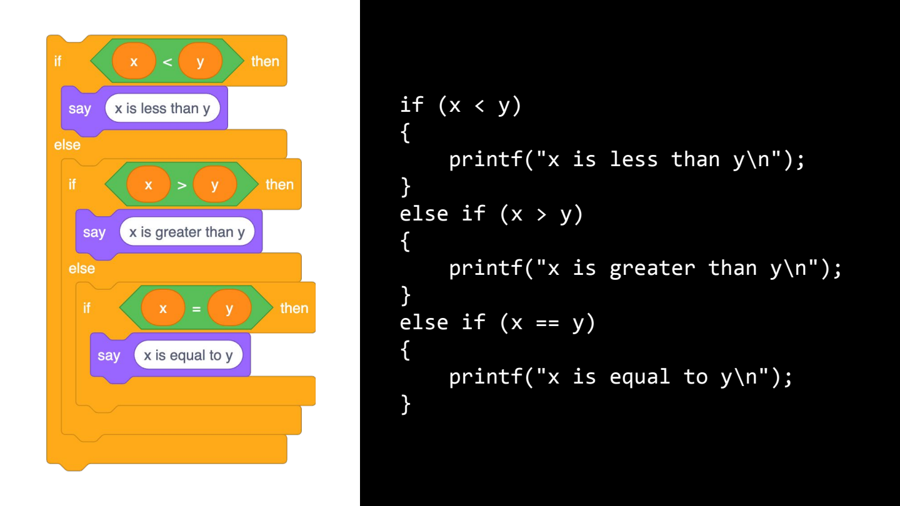
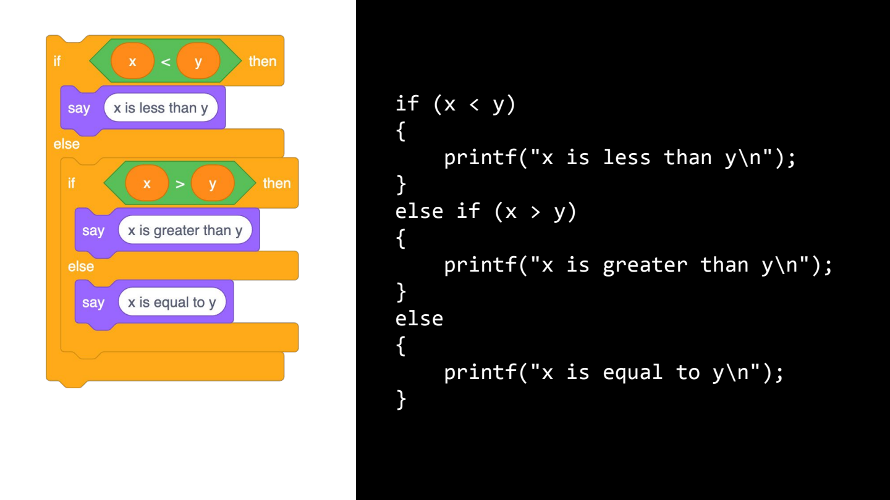
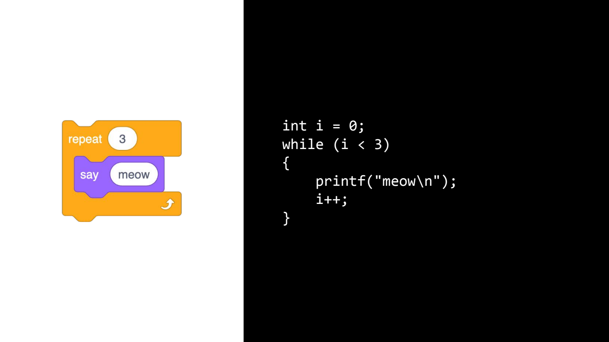
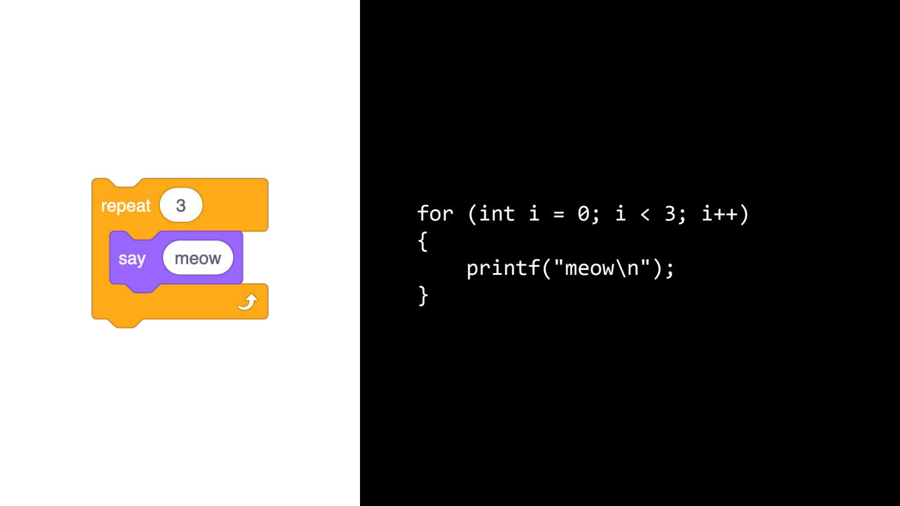
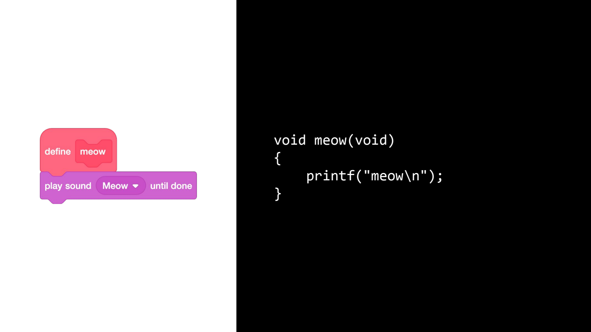

# CS50x - Week 1: C

## Source Code and Machine Code

- **source code** -> is what programmers write
- **machine code** -> is what the computer understands (only 0 and 1)

## Compiler

A **compiler** is a piece of software that someone else wrote that converts one language into another.

 

## VS Code

An IDE to write code.



- **Graphic User Interface** -> GUI
- **Command-Line Interface** -> CLI

## Terminal — basic workflow

```
code file.c   -> create file.c and open it
make file     -> compile the file
./file        -> run the file
```

## Functions

A function in code is like a function in math:

> f(x) — the function _f_ takes some input, for instance _x_, and produces some output.



---

## Escape Sequences

Special sequences of symbols:

| Sequence | Meaning                                                           |
| -------- | ----------------------------------------------------------------- |
| `\n`     | Moves you to a new line                                           |
| `\r`     | Carriage return — brings the typing head back to the left end     |
| `\"`     | Double quote — recall the phrase we tried to print "hello, world" |
| `\'`     | Single quote — same as `\"`                                       |
| `\\`     | Backslash — to print like `\`                                     |

---

## Header Files

- Files with `.h` extension.
- They contain code that other people wrote that you can use in your own programs.
- `stdio.h` -> gives us access to a library; `printf` is a feature of the header file.
- `stdio.h` defines the `printf` function.

## cs50.h

| Function     | Description                                       |
| ------------ | ------------------------------------------------- |
| `get_char`   | Get a character                                   |
| `get_double` | Get a double                                      |
| `get_float`  | Get a float                                       |
| `get_int`    | Get an integer                                    |
| `get_long`   | Get a long                                        |
| `get_string` | Get a string — `string answer = get_string(" ");` |

### Printing variables

```
printf("Hello, %s\n", answer);
```

---

## Linux

- Operating systems are the pieces of software that really do the most fundamental operations on a device (bootting it up / shutting it down).
- Linux is a very popular operating system in the programming world and in the world of servers, in the cloud and on the internet.
- It is a descendant of Unix.
- It has very high performance.
- It can have a graphical UI -> it can operate more quickly because it doesn't need graphics for humans.
- Usually used as a command-line interface (CLI).

### Linux commands

```
ls   -> list the files in my current folder (list)
mkdir -> create a new folder (make directory)
rmdir -> remove directory
rm    -> remove file
mv    -> move a file (mv hello.c hello: first file, then directory; mv hello.c old.c: change name)
cp    -> copy (cp hello.c backup.c: create a new file copied)
cd    -> change directory
```

---

## Conditionals

In C, conditionals let the program make decisions depending on whether something is true or false.

<div style="display:flex;align-items:center;gap:12px;justify-content:center">
   ➡️ 
</div>

### Operations

```
=
<
<=
>
>=
==
!=
...
```

## Types

| Type     | Bits   |
| -------- | ------ |
| `bool`   | —      |
| `char`   | —      |
| `double` | 64 bit |
| `float`  | 32 bit |
| `int`    | 32 bit |
| `long`   | 64 bit |
| `string` | —      |

## Format codes

| Code  | Description |
| ----- | ----------- |
| `%c`  | char        |
| `%f`  | float       |
| `%i`  | int         |
| `%li` | long        |
| `%s`  | string      |

## Variables

```
int counter = 0;
counter = counter + 1;  ->  counter += 1;  ->  counter++;
```

---

## Loops

- **while** loop



- **for** loop



Control-C is used to stop loops in the terminal.

---

## Creating your own functions

Create a function to solve a problem once and then reuse it.



- `void` — the return value of the function
- `void` — also the arguments to the function

If you put functions in the bottom there will be an error, so we put a prototype ahead of the main — a bit of a hint to the compiler.

```c
void meow(void);

int main(void)
{

}

void meow(void)
{

}
```

---

## Constants

A constant is a value that should never change.

```c
const int n = 3;
```
